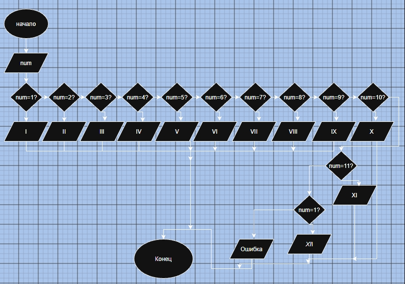

# Домашнее задание к работе №7

## 1. Алгоритм

1. Начало
2. Ввод данных: `num` — целое число (вводит пользователь).
3. Проверка значения `num` с помощью оператора `switch`:
   * Если `num` от 1 до 12, вывести соответствующую римскую цифру и значение `num`.
   * Если `num` не входит в диапазон от 1 до 12, вывести сообщение "Данного числа нет в диапазоне".
4. Конец.

## 2. Блок-схема



## 3. Реализация программы

```c
#include <stdio.h>
#include <locale.h>
#define _CRT_SECURE_NO_WARNINGS

void main() {
    setlocale(LC_ALL, "RUS");
    int num;
    
    puts("Введите число: ");
    scanf("%d", &num);
    
    switch (num) {
        case 1:
            printf("I - римская цифра %d", num);
            break;
        case 2:
            printf("II - римская цифра %d", num);
            break;
        case 3:
            printf("III - римская цифра %d", num);
            break;
        case 4:
            printf("IV - римская цифра %d", num);
            break;
        case 5:
            printf("V - римская цифра %d", num);
            break;
        case 6:
            printf("VI - римская цифра %d", num);
            break;
        case 7:
            printf("VII - римская цифра %d", num);
            break;
        case 8:
            printf("VIII - римская цифра %d", num);
            break;
        case 9:
            printf("IX - римская цифра %d", num);
            break;
        case 10:
            printf("X - римская цифра %d", num);
            break;
        case 11:
            printf("XI - римская цифра %d", num);
            break;
        case 12:
            printf("XII - римская цифра %d", num);
            break;
        default:
            printf("Данного числа нет в диапазоне");
            break;
    }
}
```

## 4. Результаты работы программы

**Пример 1. Ввод корректного числа (5)**
```text
Введите число: 
5
V - римская цифра 5
```

**Пример 2. Ввод корректного числа (12)**
```text
Введите число: 
12
XII - римская цифра 12
```

**Пример 3. Ввод числа вне диапазона (15)**
```text
Введите число: 
15
Данного числа нет в диапазоне
```

**Пример 4. Ввод нуля (0)**
```text
Введите число: 
0
Данного числа нет в диапазоне
```

## 5. Информация о разработчике

Кудрявцев Дмитрий, бИЦТ-261
